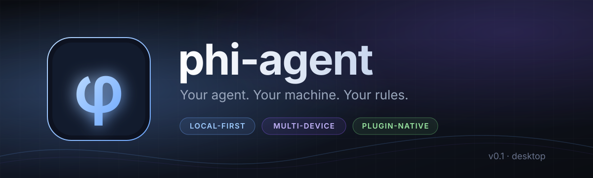

<div align="center">
  
</div>

<div align="center">

**Your agent. Your machine. Your rules.**

[](LICENSE)
[](#roadmap)
[](#requirements)

**English** · [简体中文](README.zh-CN.md)

</div>

---

phi-agent is a desktop AI agent that does real work on your computer — reading repositories, editing files, running commands, and showing you exactly what happened. It runs on your machine, keeps your sessions there, and asks before it changes anything.

No account. No upload. No surprises.

> **Ask. Approve. Watch it work. Take it back.**

## Why phi-agent?

Most agents make you choose between convenience and control. phi-agent refuses to trade one for the other.

|  | Cloud agents | IDE copilots | **phi-agent** |
|---|:---:|:---:|:---:|
| Your data stays on your device | — | Partial | **Yes, by default** |
| Works offline | — | Partial | **Yes** (except remote model calls) |
| Can read, edit, and run commands | Sometimes | Mostly edits | **Yes, with approval** |
| Every run is saved and reviewable | Rarely | — | **Yes, by default** |
| Bring your own model | — | — | **Yes** |
| Continue a task on another device | — | — | **Planned** |

## What it feels like

**1. Tell it what you want.**
*“Find out why the build is flaky and fix it.”*

**2. Approve what matters.**
Reading your workspace is automatic. Writing files and running shell commands ask first — and the approval is tied to the exact command and arguments.

**3. Watch it work.**
Messages, tool calls, approval requests, and results appear in the conversation as each step completes. The whole run stays in your session, so you can look back at what happened.

**4. Take it back.**
Cancel at any time. Every run has hard caps — 20 steps, $0.50, and 10 minutes by default. If the app closes mid-task, the run is marked for review instead of being silently retried.

## Built for people who own their tools

| | |
|---|---|
| 🔒 **Local-first**<br>Sessions and API keys stay on your machine. | 🧾 **Recorded**<br>Every run is saved and can be reviewed later. |
| 🛑 **Human approval**<br>Writes and commands wait for your explicit OK. | 💸 **Budget caps**<br>Steps, cost, and wall-clock time are bounded before they run. |
| 🧠 **Bring your own model**<br>Use your own Anthropic-compatible model endpoint and key. | 🔁 **Crash-safe**<br>Interrupted work is marked for review, never auto-retried. |
| 🖥️ **One workspace, one boundary**<br>File tools stay inside the folder you choose. | 🛰️ **Multi-device**<br>Continue a task from another device — on the roadmap. |

## Bring your own model

phi-agent works with Anthropic-compatible model endpoints. Enter your API key in the app; it stays on your machine and is sent only to the endpoint you configure.

No key? A built-in demo model takes over, so you can try the full tool-and-approval flow offline.

## A workbench, not a chat window

The main surface is a task workbench. When a visual layout helps, the agent lays out the workbench beside the conversation — plans, tables, charts, forms and buttons you can act on directly. Clicking a button or submitting a form sends that instruction back to the same agent, so the task keeps moving instead of restarting. Tick **Workbench** in the composer to let the agent shape the workbench for the next run. Approvals and tool calls work exactly the same way.

## Quick start

phi-agent is in early access. There are no packaged installers yet — build it from source.

### Requirements

- Rust 1.89+ (MSVC toolchain on Windows)
- [Bun](https://bun.sh) and the [Tauri 2 prerequisites](https://v2.tauri.app/start/prerequisites/)
- Windows: Visual Studio Build Tools with the “Desktop development with C++” workload

### Run

```bash
bun install
bun run tauri dev
```

On first launch, phi-agent creates a `phi-workspace` folder in your Documents directory. You can change it in the app.

## Safety you can see

Giving an agent the ability to edit files and run commands is serious. phi-agent treats it that way:

- **Deny by default.** Unknown tools and paths outside the workspace are refused.
- **Approval is bound to the action.** Your OK applies to the exact tool, workspace, and normalized arguments. Change an argument — or the file you approved — and the approval no longer matches.
- **File tools stay in the workspace.** The folder you choose is the boundary for reading and writing files.
- **Shell commands use your permissions.** Command execution is not sandboxed like a virtual machine, so the approval prompt is the real safety boundary. Read it before you approve.
- **Cancellation is real.** Commands that may have already had an effect are marked “outcome unknown” instead of pretending otherwise.
- **Cost cannot run away.** Every model call reserves budget first; the hard cap holds even when calls fail.

## Roadmap

- [x] **v0.1 — Desktop** · real coding tasks, approvals, budget caps, cancellation, crash recovery
- [ ] **v1 — Beyond one window** · work from more than one device, installable extensions, basic memory
- [ ] **Later** · task handoff across devices, extensions marketplace

## FAQ

<details>
<summary><b>Does phi-agent upload my data?</b></summary>

No. Sessions and API keys are local by default. Network traffic goes only to the model endpoint you configure.
</details>

<details>
<summary><b>Can I use it offline?</b></summary>

Yes, except for calls to a remote model. Without an API key, the built-in demo model lets you exercise the full loop and approval flow offline.
</details>

<details>
<summary><b>Is it sandboxed like a virtual machine?</b></summary>

Not yet. File tools are confined to the workspace folder, but shell commands run with your own user permissions. Treat the approval prompt and your workspace choice as the real boundary.
</details>

<details>
<summary><b>Which models are supported?</b></summary>

Anthropic-compatible endpoints today. Local models are on the roadmap.
</details>

<details>
<summary><b>Where are my API keys stored?</b></summary>

On your machine, in the app's local data folder. They are only sent to the model endpoint you configure.
</details>

<details>
<summary><b>What happens if I close the app mid-task?</b></summary>

The run stops and is marked for review the next time you open the app. It is never retried automatically, because a command may already have changed something.
</details>

## Contributing

phi-agent is built in the open. Issues, design discussions, and pull requests are welcome — start with [CONTRIBUTING.md](CONTRIBUTING.md). For security reports, please follow [SECURITY.md](SECURITY.md).

## License

[GNU General Public License v3.0](LICENSE) · `GPL-3.0-only`

<div align="center"><sub>Your agent. Your machine. Your rules.</sub></div>
