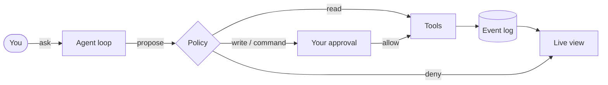

<div align="center">
  
</div>

<div align="center">

**Your agent. Your machine. Your rules.**

[](LICENSE)
[](docs/80-roadmap/evolution.md)
[](#requirements)
[](https://tauri.app)

**English** · [简体中文](README.zh-CN.md)

</div>

---

phi-agent is a desktop AI agent that does real work on your computer — reading repositories, editing files, running commands, and showing you exactly what happened. It runs on your machine, keeps your data there, and asks before it changes anything.

No account. No upload. No surprises.

> **Ask. Approve. Watch it work. Take it back.**

## Why phi-agent?

Most agents make you choose between convenience and control. phi-agent refuses to trade one for the other.

|  | Cloud agents | IDE copilots | **phi-agent** |
|---|:---:|:---:|:---:|
| Your data stays on your device | — | Partial | **Yes, by default** |
| Works offline | — | Partial | **Yes** (except remote model calls) |
| Can read, edit, and run commands | Sometimes | Mostly edits | **Yes, with approval** |
| Every step is auditable | Rarely | — | **Event log by default** |
| Replaceable models, tools, and UI | — | — | **Everything is a plugin** |
| Continue a task on another device | — | — | **Planned** |

## What it feels like

**1. Tell it what you want.**
*“Find out why the build is flaky and fix it.”*

**2. Approve what matters.**
Reading your workspace is automatic. Writing files and running shell commands ask first — and the approval is tied to the exact command and arguments.

**3. Watch every step.**
Thoughts, tool calls, policy decisions, and results stream into a live view. The same history is persisted as an event log, ready to replay.

**4. Take it back.**
Cancel at any time. Hard caps on steps, cost, and wall-clock time stop runaway runs. If the app dies mid-task, the run is parked for review instead of being silently retried.

## Built for people who own their tools

| | |
|---|---|
| 🔒 **Local-first**<br>Sessions, memory, and keys stay on your machine. | 🧾 **Auditable**<br>Every action is an event you can inspect and replay. |
| 🛑 **Human approval**<br>Writes and commands wait for your explicit OK. | 💸 **Budget caps**<br>Steps, cost, and wall-clock time are bounded before they run. |
| 🧩 **Plugins all the way down**<br>Swap models, tools, policies, and UI. | 🔁 **Crash-safe**<br>Interrupted work is parked for review, never auto-retried. |
| 🧠 **Bring your own model**<br>Anthropic-compatible endpoints today. | 🛰️ **Multi-device**<br>One kernel for every screen — on the roadmap. |

## Bring your own model

phi-agent talks to Anthropic-compatible APIs. Point it at the official endpoint or your own gateway:

- Enter `ANTHROPIC_API_KEY` in the app (kept in memory only), or set it in your environment.
- Override the endpoint with `PHI_ANTHROPIC_BASE_URL`.
- No key? A deterministic mock model takes over, so you can explore the full approval flow offline.

## Quick start

phi-agent is in early access. There are no packaged installers yet — build it from source.

### Requirements

- Rust 1.85+ (MSVC toolchain on Windows)
- [Bun](https://bun.sh) and the [Tauri 2 prerequisites](https://v2.tauri.app/start/prerequisites/)
- Windows: Visual Studio Build Tools with the “Desktop development with C++” workload

### Run

```bash
bun install
bun run tauri dev
```

On first launch, phi-agent creates a `phi-workspace` folder in your Documents directory. You can change it in the app.

## Safety you can see

Giving an agent the ability to edit files and run commands is serious. phi-agent treats it that way:

- **Deny by default.** Unknown tools and paths outside the workspace are refused.
- **Approval is bound to the action.** Your OK applies to the exact tool, workspace, and normalized arguments. Change an argument and the approval no longer matches.
- **The workspace is a jail.** File tools stay inside the folder you choose.
- **Cancellation is real.** Commands that may have already had an effect are marked “outcome unknown” instead of pretending otherwise.
- **Cost cannot run away.** Every model call reserves budget first; the hard cap holds even when calls fail.

## Under the hood

For the curious: a narrow Rust kernel, event-sourced sessions, and ports for every platform capability. Models, tools, policies, sandboxes, and even the UI are plugins. Remove one and the rest keeps working — that is the point.



See the [design documents](docs/README.md) for the full story.

## Roadmap

- [x] **v0.1 — Desktop** · real coding tasks, approvals, budget caps, cancellation, crash recovery
- [ ] **v1 — Beyond one window** · headless server node, installable TypeScript plugins, basic memory
- [ ] **Later** · task handoff across devices, state replication, plugin market

## FAQ

<details>
<summary><b>Does phi-agent upload my data?</b></summary>

No. Sessions, memory, and keys are local by default. Network traffic goes only to the model endpoint you configure.
</details>

<details>
<summary><b>Can I use it offline?</b></summary>

Yes, except for calls to a remote model. Without an API key, the built-in mock model lets you exercise the full loop and approval flow offline.
</details>

<details>
<summary><b>Is it sandboxed like a virtual machine?</b></summary>

Not yet. The current sandbox is a workspace path jail plus process termination, not OS-level isolation. Treat approvals and your workspace choice as the real boundary.
</details>

<details>
<summary><b>Which models are supported?</b></summary>

Any Anthropic-compatible endpoint today. Local models are on the roadmap.
</details>

## Contributing

phi-agent is built in the open. Issues, design discussions, and pull requests are welcome — start with [CONTRIBUTING.md](CONTRIBUTING.md). For security reports, please follow [SECURITY.md](SECURITY.md).

## License

[GNU General Public License v3.0](LICENSE) · `GPL-3.0-only`

<div align="center"><sub>Built with Rust, Tauri, and Solid. Your agent. Your machine. Your rules.</sub></div>
