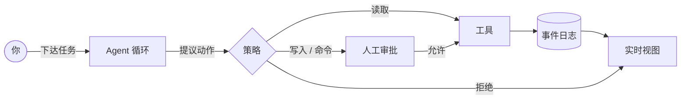

<div align="center">
  
</div>

<div align="center">

**你的 Agent，你的机器，你的规则。**

[](LICENSE)
[](docs/80-roadmap/evolution.md)
[](#环境要求)
[](https://tauri.app)

[English](README.md) · **简体中文**

</div>

---

phi-agent 是一个真正在你电脑上干活的桌面 AI Agent：读代码、改文件、跑命令，并把每一步都展示给你。它运行在你的设备上，数据默认不离开本机，动手之前先征求你的同意。

不用注册，不上传数据，不做意外的事。

> **下达任务。批准动作。看着它干活。随时收回控制权。**

## 为什么选择 phi-agent？

大多数 Agent 让你在「方便」和「可控」之间二选一。phi-agent 不做这个交易。

|  | 云端 Agent | IDE 助手 | **phi-agent** |
|---|:---:|:---:|:---:|
| 数据留在你的设备上 | — | 部分 | **默认如此** |
| 离线可用 | — | 部分 | **可以**（远程模型调用除外） |
| 能读文件、改文件、跑命令 | 有时 | 以编辑为主 | **可以，且需审批** |
| 每一步都可审计 | 很少 | — | **默认事件日志** |
| 模型、工具、界面可替换 | — | — | **一切都是插件** |
| 换台设备继续任务 | — | — | **规划中** |

## 用起来是什么感觉

**1. 告诉它你想做什么。**
*「查一下构建为什么不稳定，然后修好它。」*

**2. 批准真正重要的动作。**
读取工作区自动允许；写文件和执行命令会先询问——审批绑定到确切的命令与参数。

**3. 看着每一步发生。**
思考、工具调用、策略判定与结果实时流入界面；同样的历史会持久化为事件日志，随时可以回放。

**4. 随时收回控制权。**
任何时候都能取消。步数、成本与墙钟时间都有硬上限，失控的运行会被立刻叫停。如果应用中途崩溃，任务会停在待核对状态，而不是被悄悄重试。

## 为「自己的工具自己做主」的人而做

| | |
|---|---|
| 🔒 **本地优先**<br>会话、记忆与密钥留在你的机器上。 | 🧾 **可审计**<br>每个动作都是可检查、可回放的事件。 |
| 🛑 **人工审批**<br>写入与命令执行需要你明确同意。 | 💸 **预算上限**<br>步数、成本与墙钟时间在运行前就被约束。 |
| 🧩 **彻底插件化**<br>模型、工具、策略与界面都能替换。 | 🔁 **崩溃安全**<br>中断的任务停在待核对状态，绝不自动重试。 |
| 🧠 **自带模型**<br>今天支持 Anthropic 兼容端点。 | 🛰️ **多端协同**<br>一套内核跑遍所有屏幕——规划中。 |

## 自带模型

phi-agent 通过 Anthropic 兼容 API 调用模型，可以指向官方端点，也可以指向你自己的网关：

- 在应用内填入 `ANTHROPIC_API_KEY`（仅保存在内存中），或通过环境变量设置。
- 用 `PHI_ANTHROPIC_BASE_URL` 覆盖端点地址。
- 没有密钥？内置的确定性 Mock 模型会接管，离线也能体验完整的工具回路与审批流程。

## 快速开始

phi-agent 处于早期体验阶段，暂时没有打包好的安装程序，需要从源码构建。

### 环境要求

- Rust 1.85+（Windows 使用 MSVC 工具链）
- [Bun](https://bun.sh) 以及 [Tauri 2 的平台依赖](https://v2.tauri.app/start/prerequisites/)
- Windows：安装 Visual Studio Build Tools 的「使用 C++ 的桌面开发」工作负载

### 运行

```bash
bun install
bun run tauri dev
```

首次启动会在系统文档目录下创建 `phi-workspace` 文件夹，可在应用内修改。

## 看得见的安全边界

让 Agent 改文件、跑命令是一件严肃的事，phi-agent 认真对待：

- **默认拒绝。** 未知工具与工作区外的路径一律拒绝。
- **审批绑定动作。** 你的「同意」只对确切的工具、工作区与规范化参数有效；参数一变，审批立即失效。
- **工作区即牢笼。** 文件工具被限制在你选择的目录内。
- **取消是真的取消。** 可能已经产生副作用的命令会被标记为「结果未知」，而不是假装什么都没发生。
- **成本不会失控。** 每次模型调用前先预留预算；即使调用失败，硬上限依然成立。

## 内核之下

如果你好奇：一个狭义 Rust 内核、事件溯源的会话，以及覆盖所有平台能力的端口。模型、工具、策略、沙箱甚至界面都是插件——删掉其中一个，其余部分照常工作，这正是它的意义。



完整故事见[设计文档](docs/README.md)。

## 路线图

- [x] **v0.1 — 桌面端** · 真实编码任务、人工审批、预算上限、取消、崩溃恢复
- [ ] **v1 — 不止一扇窗** · 无头服务器节点、可安装 TypeScript 插件、基础记忆
- [ ] **更远** · 任务换端继续、状态复制、插件市场

## 常见问题

<details>
<summary><b>phi-agent 会上传我的数据吗？</b></summary>

不会。会话、记忆与密钥默认留在本地。网络流量只会发往你配置的模型端点。
</details>

<details>
<summary><b>可以离线使用吗？</b></summary>

可以，远程模型调用除外。没有密钥时，内置 Mock 模型能让你离线体验完整的循环与审批流程。
</details>

<details>
<summary><b>它像虚拟机一样隔离吗？</b></summary>

暂时不是。当前沙箱是工作区路径 jail 加进程终止，不是操作系统级隔离。请把审批和你的工作区选择当作真正的边界。
</details>

<details>
<summary><b>支持哪些模型？</b></summary>

目前支持任意 Anthropic 兼容端点。本地模型在路线图上。
</details>

## 参与贡献

phi-agent 在开放中构建。欢迎提交 Issue、参与设计讨论或发起 Pull Request，请先阅读 [CONTRIBUTING.md](CONTRIBUTING.md)。安全问题请按 [SECURITY.md](SECURITY.md) 私下报告。

## 许可证

[GNU General Public License v3.0](LICENSE) · `GPL-3.0-only`

<div align="center"><sub>Built with Rust, Tauri, and Solid. 你的 Agent，你的机器，你的规则。</sub></div>
