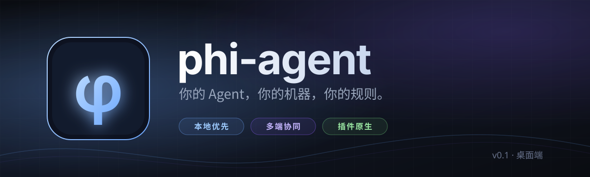

<div align="center">
  
</div>

<div align="center">

**你的 Agent，你的机器，你的规则。**

[](LICENSE)
[](#路线图)
[](#环境要求)

[English](README.md) · **简体中文**

</div>

---

phi-agent 是一个真正在你电脑上干活的桌面 AI Agent：读代码、改文件、跑命令，并把发生的一切展示给你。它运行在你的设备上，会话留在本机，动手之前先征求你的同意。

不用注册，不上传数据，不做意外的事。

> **下达任务。批准动作。看着它干活。随时收回控制权。**

## 为什么选择 phi-agent？

大多数 Agent 让你在「方便」和「可控」之间二选一。phi-agent 不做这个交易。

|  | 云端 Agent | IDE 助手 | **phi-agent** |
|---|:---:|:---:|:---:|
| 数据留在你的设备上 | — | 部分 | **默认如此** |
| 离线可用 | — | 部分 | **可以**（远程模型调用除外） |
| 能读文件、改文件、跑命令 | 有时 | 以编辑为主 | **可以，且需审批** |
| 每次运行都被保存、可回看 | 很少 | — | **默认如此** |
| 自带模型 | — | — | **可以** |
| 换台设备继续任务 | — | — | **规划中** |

## 用起来是什么感觉

**1. 告诉它你想做什么。**
*「查一下构建为什么不稳定，然后修好它。」*

**2. 批准真正重要的动作。**
读取工作区自动允许；写文件和执行命令会先询问——审批绑定到确切的命令与参数。

**3. 看着它干活。**
消息、工具调用、审批请求和结果会在每一步完成时出现在对话里。整次运行都留在会话中，随时可以回看发生了什么。

**4. 随时收回控制权。**
任何时候都能取消。每次运行都有硬上限——默认 20 步、$0.50、10 分钟。如果应用中途关闭，任务会被标记为待核对，而不是被悄悄重试。

## 为「自己的工具自己做主」的人而做

| | |
|---|---|
| 🔒 **本地优先**<br>会话与 API Key 留在你的机器上。 | 🧾 **有记录**<br>每次运行都会被保存，之后可以回看。 |
| 🛑 **人工审批**<br>写入与命令执行需要你明确同意。 | 💸 **预算上限**<br>步数、成本与墙钟时间在运行前就被约束。 |
| 🧠 **自带模型**<br>使用你自己的 Anthropic 兼容模型端点与密钥。 | 🔁 **崩溃安全**<br>中断的任务标记为待核对，绝不自动重试。 |
| 🖥️ **一个工作区，一条边界**<br>文件工具只在你选择的目录内活动。 | 🛰️ **多端协同**<br>换台设备继续任务——规划中。 |

## 自带模型

phi-agent 支持 Anthropic 兼容的模型端点。在应用里填入 API Key 即可；密钥留在你的机器上，只会发往你配置的端点。

没有密钥也没关系：内置的演示模型会接管，离线也能体验完整的工具调用与审批流程。

## 是工作台，不是聊天窗口

主界面是任务工作台。当可视化布局有帮助时，Agent 会在对话旁布置工作台——计划、表格、图表、表单和按钮，可以直接操作。点击按钮或提交表单，会把对应指令发回同一个 Agent，任务继续推进而不是从头开始。在输入框勾选 **工作台**，即可让 Agent 为下一次运行布置工作台。审批与工具调用的行为完全不变。

## 快速开始

phi-agent 处于早期体验阶段，暂时没有打包好的安装程序，需要从源码构建。

### 环境要求

- Rust 1.89+（Windows 使用 MSVC 工具链）
- [Bun](https://bun.sh) 以及 [Tauri 2 的平台依赖](https://v2.tauri.app/start/prerequisites/)
- Windows：安装 Visual Studio Build Tools 的「使用 C++ 的桌面开发」工作负载

### 运行

```bash
bun install
bun run tauri dev
```

首次启动会在系统文档目录下创建 `phi-workspace` 文件夹，可在应用内修改。

## 看得见的安全边界

让 Agent 改文件、跑命令是一件严肃的事，phi-agent 认真对待：

- **默认拒绝。** 未知工具与工作区外的路径一律拒绝。
- **审批绑定动作。** 你的「同意」只对确切的工具、工作区与规范化参数有效；参数一变，或者已批准的文件发生变化，审批立即失效。
- **文件工具留在工作区。** 你选择的文件夹就是读写文件的边界。
- **命令使用你的用户权限。** 命令执行不是虚拟机级的隔离，审批提示才是真正的安全边界。批准前请认真阅读。
- **取消是真的取消。** 可能已经产生副作用的命令会被标记为「结果未知」，而不是假装什么都没发生。
- **成本不会失控。** 每次模型调用前先预留预算；即使调用失败，硬上限依然成立。

## 路线图

- [x] **v0.1 — 桌面端** · 真实编码任务、人工审批、预算上限、取消、崩溃恢复
- [ ] **v1 — 不止一扇窗** · 换台设备继续工作、可安装的扩展、基础记忆
- [ ] **更远** · 跨设备任务交接、扩展市场

## 常见问题

<details>
<summary><b>phi-agent 会上传我的数据吗？</b></summary>

不会。会话与 API Key 默认留在本地。网络流量只会发往你配置的模型端点。
</details>

<details>
<summary><b>可以离线使用吗？</b></summary>

可以，远程模型调用除外。没有密钥时，内置的演示模型能让你离线体验完整的循环与审批流程。
</details>

<details>
<summary><b>它像虚拟机一样隔离吗？</b></summary>

暂时不是。文件工具被限制在工作区目录内，但命令会以你自己的用户权限运行。请把审批提示和你的工作区选择当作真正的边界。
</details>

<details>
<summary><b>支持哪些模型？</b></summary>

目前支持 Anthropic 兼容的端点。本地模型在路线图上。
</details>

<details>
<summary><b>我的 API Key 存在哪里？</b></summary>

存在你机器上的应用数据目录里，只会发往你配置的模型端点。
</details>

<details>
<summary><b>任务跑到一半关掉应用会怎样？</b></summary>

运行会停止，并在下次打开应用时标记为待核对。它绝不会自动重试，因为命令可能已经改动了东西。
</details>

## 参与贡献

phi-agent 在开放中构建。欢迎提交 Issue、参与设计讨论或发起 Pull Request，请先阅读 [CONTRIBUTING.md](CONTRIBUTING.md)。安全问题请按 [SECURITY.md](SECURITY.md) 私下报告。

## 许可证

[GNU General Public License v3.0](LICENSE) · `GPL-3.0-only`

<div align="center"><sub>你的 Agent，你的机器，你的规则。</sub></div>
